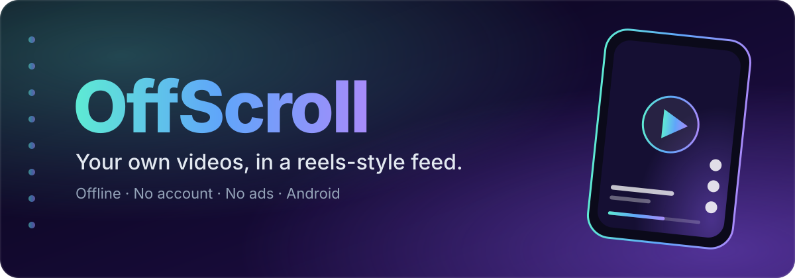

<div align="center">



<br/>

[](https://github.com/yourfriendy/video-player/releases/latest/download/OffScroll.apk)

[](https://github.com/yourfriendy/video-player/actions/workflows/build-apk.yml)
[](https://github.com/yourfriendy/video-player/releases/latest)


**Swipe through the videos already on your phone, the way you would on a short-video app,<br/>without the account, the ads, the algorithm or the internet connection.**

</div>

---

## ✨ Why OffScroll?

Your gallery is full of videos you never rewatch because a grid of thumbnails is a chore to browse.
OffScroll turns that folder into a **full-screen vertical feed**: swipe, double-tap to like, keep what you love, and move on.

|  |  |
|---|---|
| 📴 **Plays offline** | Plays files straight from your device. Your videos never leave your phone, and the app only goes online when you ask it to save an Instagram reel. |
| 🔒 **Minimal permission** | Only asks to read your videos (`READ_MEDIA_VIDEO`). |
| 🚫 **No accounts, no ads** | Install it and start watching. |
| ⚡ **Buttery swiping** | A shared pool of Media3 players, the next video preloaded, and an R8-optimised release build. |

## 🎬 Features

<table>
<tr>
<td width="50%" valign="top">

### Watch
- 📱 Full-screen **vertical swipe feed**
- ❤️ **Double-tap to like**
- ⏯️ Tap to reveal controls, tap again to play/pause
- 🎚️ **Scrub bar** and horizontal-drag seeking
- 🔆 **Brightness** (left edge) and 🔊 **volume** (right edge) swipes with a live level indicator
- ⏭️ Auto-advance to the next video when loop is off
- ⏱️ **Resume** long videos where you left off
- 🔁 Loop, mute and **playback speed**
- 🖼️ Display modes: **Crop / Fit / Stretch**
- 🪟 **Picture-in-picture**

</td>
<td width="50%" valign="top">

### Find
- 🔎 A dedicated **search page**: instant results with thumbnails, highlighted matches and a favorite badge
- 🧠 Smart matching: ignores case, punctuation and extensions (`neon cyber` finds `Neon_Cyber_Loop.mp4`)
- 🎛️ Narrow by **length**, **favorites**, **folder** and **sort order**
- 🕘 **Recent searches**, quick picks, *Recently added* and *Continue watching*
- ▶️ Tap a result to play that exact video; the feed becomes your results, and **✕ on the search chip returns to the full feed on the same video**
- 🗂️ Feed filters: folder, recently added / played, favorites, duration
- ↕️ Sort by date, duration, size or name, plus **shuffle** that keeps your place

</td>
</tr>
<tr>
<td valign="top">

### Save
- 📥 **Instagram reel downloader**: paste a public reel link, or use Instagram's **Share → OffScroll** and it saves automatically
- 📸 **Instagram stories**: type a **username or link** and save one story, all of them, or a highlight (videos *and* photos)
- 🎬 Saved reels land in `Movies/OffScroll` and show up in your feed instantly, with a *Play now* button

### Keep
- ⭐ **Favorites**
- ⏰ **Watch Later**
- 📚 **Playlists** with emoji
- 🕘 **Watch history**

</td>
<td valign="top">

### Manage
- ℹ️ **Metadata inspector** for any video
- 📤 **Share** a video
- 🗑️ **Delete** with the system's confirmation dialog (your favorites and playlists are only cleaned up once the file is really gone)

</td>
</tr>
</table>

## 📲 Install

1. Open the **[latest release](https://github.com/yourfriendy/video-player/releases/latest)** on your Android phone.
2. Download **`OffScroll.apk`**.
3. Open it and allow *"Install from this source"* if Android asks.
4. Launch OffScroll and grant access to your videos.

> [!NOTE]
> The APK is **debug-signed**, so Android may show an "unknown app" warning. That's expected for apps installed outside the Play Store.

## 📥 Saving Instagram reels

1. In Instagram, open a reel and tap **Share → Copy link**, then open OffScroll, tap the **download icon** and paste. 
2. Or tap **Share → OffScroll** right inside Instagram and the download starts by itself.

### Stories

Stories are never public, so this tab needs **your own Instagram login**:

1. Open the download sheet and switch to **Stories**.
2. Tap **Sign in with Instagram**. You sign in on Instagram's own page, so OffScroll never sees your password. *Sign out* is one tap away.
3. Type a **username** (`@name`) to see every current story, or paste a **story link** for just that one, then save them one by one or **Download all**.

Videos are saved to `Movies/OffScroll` (and appear in the feed); photos go to `Pictures/OffScroll`. You can only see stories your own account could already see in the Instagram app, and stories disappear after 24 hours.

> [!WARNING]
> Instagram doesn't officially allow third-party tools and may limit accounts that use them. A spare account is the safer choice. The sign-in session is kept in the app's private storage only and is excluded from backups.

> [!IMPORTANT]
> Reels: only **public** reels can be saved, and some creators turn downloads off. Please only keep videos you have permission to save, and respect the creator's rights. Instagram has no official download API, so this reads the public page and may need an update if Instagram changes how it works.

## 🕹️ Gestures at a glance

| Gesture | What it does |
|---|---|
| **Swipe up / down** | Next / previous video |
| **Tap** | Show controls (tap again to play / pause) |
| **Double-tap** | Like ❤️ |
| **Slide along the left edge** | Brightness 🔆 |
| **Slide along the right edge** | Volume 🔊 |
| **Drag along the progress bar** | Scrub through the video |
| **Search icon** | Find a video, then tap a result to play it |
| **Download icon** | Save a public Instagram reel from its link |
| **Gear icon** | Settings and guide |

## 🛠️ Tech stack

| | |
|---|---|
| **Language / UI** | Kotlin · Jetpack Compose · Material 3 |
| **Playback** | AndroidX Media3 (ExoPlayer) |
| **Storage** | Room (favorites, playlists, history, Watch Later) |
| **Images** | Coil (with video-frame thumbnails) |
| **Architecture** | MVVM with a single `ViewModel` and `StateFlow` UI state; search runs off the main thread |
| **CI** | GitHub Actions builds the APK and publishes it to Releases |

## 🧱 Build from source

You need **Android Studio** (latest stable) and **JDK 17+**.

```bash
git clone https://github.com/yourfriendy/video-player.git
cd video-player/"video player"
```

Open the `video player` folder in Android Studio, let Gradle sync, then press **Run ▶**.

Or from the command line, with Gradle 9.3.1 installed:

```bash
gradle :app:assembleDebug
# → app/build/outputs/apk/debug/app-debug.apk
```

> The debug build expects a `debug.keystore` in the project folder (it's git-ignored). Android Studio creates one for you, or run:
> `keytool -genkeypair -keystore debug.keystore -storepass android -keypass android -alias androiddebugkey -keyalg RSA -keysize 2048 -validity 10000 -dname "CN=Android Debug,O=Android,C=US"`

### 🤖 Automatic APK builds

Every push to `main` runs [`build-apk.yml`](.github/workflows/build-apk.yml), which builds an **R8-optimised, release-signed** APK and replaces the **`latest`** release with a fresh `OffScroll.apk`, so the newest build is always one tap away from the repo's front page.

## 📁 Project layout

```text
video player/app/src/main/java/com/example/
├── data/            Room database, DAOs, MediaStore repository, settings
├── ui/
│   ├── components/  Feed, player pool, search page, side gestures, settings, sheets
│   ├── navigation/  Feed ⇄ Settings
│   ├── viewmodel/   VideoFeedViewModel (feed state, filters, search engine, playback)
│   └── model/       Filters, sort options, display modes
└── MainActivity.kt  Permission flow, PiP, app entry point
```

## 🗺️ Ideas for later

- Subtitle support
- Backup and restore of favorites and playlists
- Home-screen shortcuts for playlists

## 🤝 Contributing

Issues and pull requests are welcome. If you found a bug, tell us your Android version, your device, and what you were doing when it happened.

---

<div align="center">

Made by **Madhu Yadav** ❤️‍🔥 for people who just want to watch their own videos.

</div>
